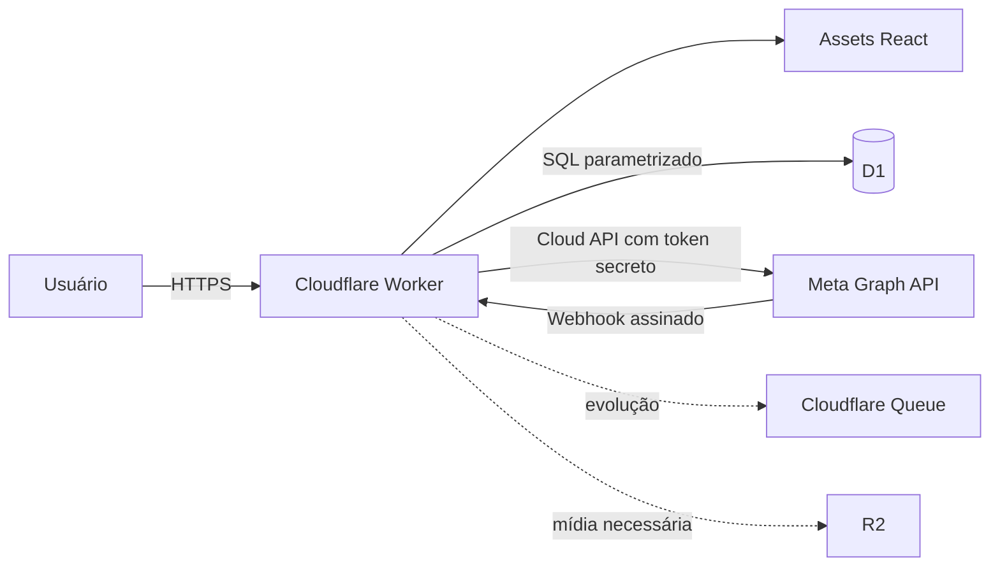

# AV flow CRM — arquitetura e plano de evolução

**AV significa Acelera Vendas.**

## Estado verificável

O provisionamento Payload do Figma Make não foi disponibilizado pelo ambiente. Este repositório usa uma alternativa portátil e econômica: React/Vite publicado como assets de um Cloudflare Worker, API no mesmo domínio e Cloudflare D1. O código está implementado, mas a persistência remota e a integração Meta **não estão ativas** até criar o D1, aplicar as migrações e configurar segredos.

## Componentes e fluxo

- **Frontend:** React, TypeScript, design system local e API same-origin.
- **Backend:** Worker sem framework; cookies `HttpOnly`, `Secure`, `SameSite=Lax`.
- **Banco:** D1/SQLite, migrações versionadas, `organization_id` em todas as entidades privadas.
- **Assíncrono:** webhook apenas valida e registra eventos idempotentes. Antes de escala de produção, conectar Queue para processamento e retentativas.
- **Segredos:** somente bindings/secrets do Worker. Tokens Meta nunca são enviados ao navegador nem armazenados nas tabelas desta versão.

## Fronteira de segurança multiempresa

O Worker resolve `user_id`, `organization_id` e papel exclusivamente pela sessão. IDs de organização enviados pelo cliente são ignorados. Toda consulta privada inclui `WHERE organization_id = ?`. Operações administrativas devem ainda validar papel. D1 não oferece RLS: a camada de API e testes de isolamento são controles obrigatórios.

## Fluxos

1. **Cadastro:** valida entrada → PBKDF2 no Worker → transação lógica via batch cria empresa, usuário, membro admin e assinatura → sessão.
2. **Login:** limite por conta (5 falhas, bloqueio de 15 min) → sessão aleatória persistida apenas como SHA-256 → cookie seguro.
3. **WhatsApp:** Embedded Signup retorna autorização ao backend → backend troca código conforme documentação vigente → salva apenas IDs; token deve ficar em secret store dedicada. Este passo está pendente.
4. **Entrada:** Meta chama webhook → HMAC `X-Hub-Signature-256` → resolve `phone_number_id` único → grava evento com chave idempotente → processamento cria contato/conversa/mensagem na organização correspondente.
5. **Saída:** usuário autenticado → valida organização, integração e janela de atendimento → cria estado `queued` → Graph API → persiste ID/status real. Não marcar entregue antes do webhook.
6. **Atribuição:** aceitar somente referência CTWA/Lead Ads, UTM capturada, CSV mapeado ou correção manual auditada. Ausência de evidência permanece `unknown`.

## Páginas

- Entrar, criar conta, recuperar senha e aceitar convite.
- Visão geral.
- Caixa de entrada (conversas, mensagens, qualificação).
- Leads/funil, tarefas, campanhas, importações e relatórios.
- Equipe, integrações, plano, segurança e privacidade.
- Superadmin isolado, sem leitura padrão do conteúdo de conversas.

## Permissões

| Ação | Superadmin | Admin | Gerente | Atendente |
|---|---:|---:|---:|---:|
| Infraestrutura e suspensão | Sim | Não | Não | Não |
| Configurar integração/plano/equipe | Não por padrão | Sim | Não | Não |
| Relatórios e exportação | Metadados | Sim | Sim | Próprios |
| Atender e qualificar | Suporte auditado | Sim | Sim | Sim |
| Excluir/exportar dados LGPD | Fluxo auditado | Sim | Solicita | Não |

## Pastas

`src/` interface; `worker/` API; `migrations/` D1; `docs/` arquitetura, implantação e conformidade; `tests/` testes automatizados.

## Plano de testes

- Unitários: normalização, métricas, assinatura, idempotência e validação.
- Integração local D1: cadastro/login, expiração, CRUD, histórico e isolamento A/B.
- Contrato Meta: fixtures sanitizadas para webhook válido, inválido, duplicado e fora de ordem.
- E2E: acessibilidade, responsividade e fluxos críticos.
- Externos: envio/recebimento com número de teste e credenciais autorizadas; não executados neste ambiente.

## Modelo e retenção

O SQL está em `migrations/0001_initial.sql`. Conteúdo de mensagem é dado pessoal: definir prazo contratual, excluir após o prazo e manter somente auditoria mínima. Exportação e exclusão devem ser jobs auditados. Backups D1 e restauração precisam ser ensaiados antes de produção. Política, termos, bases legais, controlador/operador e atendimento de titulares exigem revisão jurídica brasileira.
